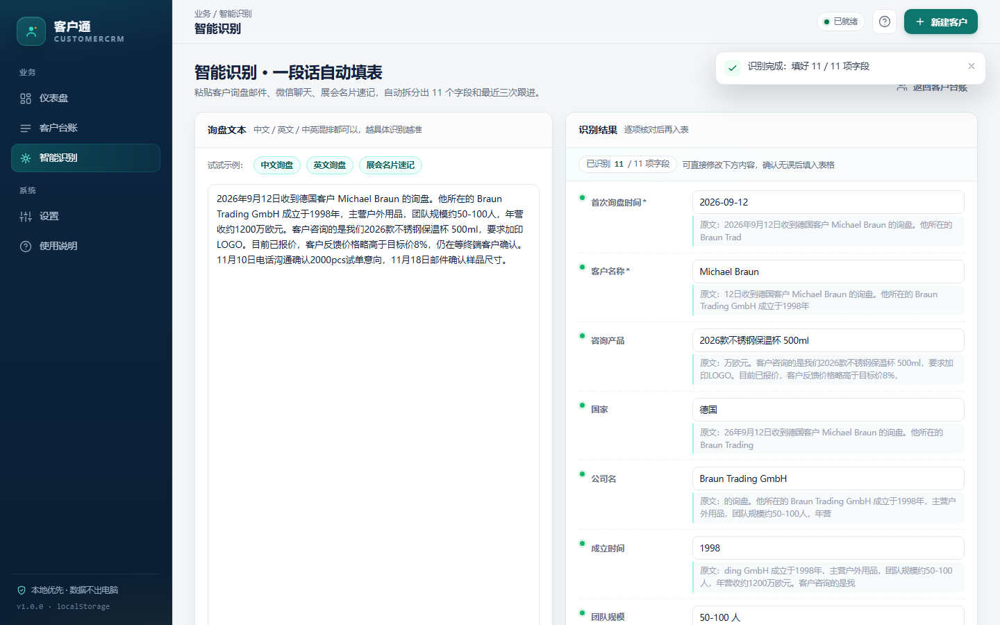

# 客户通 CustomerCRM · 外贸客户管理系统

一套**免部署、零后端、数据留在本机**的外贸客户管理 Web 系统。询盘一进来就录入，跟进状态与「距上次跟进」一目了然，一键导出 Excel，粘贴一整段询盘文本还能自动填表。

- **在线使用**：<https://joyzqj.github.io/customercrm/>
- **源码仓库**：<https://github.com/joyzqj/customercrm>
- **姊妹系统**：[单证通 TradeDocs](https://joyzqj.github.io/tradedocs/)（外贸单证），同一套设计语言

> 纯静态页面：不需要服务器、不需要数据库、不需要联网。双击 `index.html` 就能用，也可以放到 GitHub Pages / 内网静态目录。


---

## 功能一览

| 能力 | 说明 |
| --- | --- |
| 客户台账 | 首次询盘时间、客户名称、咨询产品、国家、公司名、成立时间、团队规模、年营收、跟进状态、是否成交、核心原因，共 11 个核心字段 |
| 最近三次跟进 | 每位客户保留最近 3 条跟进记录（日期 + 内容），表格行首箭头展开查看，可随时补记 |
| 距上次跟进 | 按最近一条跟进日期实时计算天数，7 天内绿色 / 7–13 天琥珀 / ≥14 天红色，阈值可自定义 |
| 一键导出 Excel | 生成真实 `.xlsx`：表头样式、冻结首行、自动筛选、列宽与换行；两个工作表「客户总表」+「跟进明细」 |
| 一键识别文本 | 把询盘邮件 / 微信聊天 / 展会名片速记整段粘进来，自动拆分 11 个字段 + 最近三次跟进，识别结果可手动修正 |
| 仪表盘 | 客户总数 / 已成交 / 待跟进 / 超期未跟进、国家分布、跟进状态分布、最近跟进动态、优先跟进清单 |
| 搜索与筛选 | 关键词（客户、公司、产品、国家、原因、跟进内容）+ 国家 / 跟进状态 / 成交筛选 + 多列排序 |
| 数据安全 | 全部数据存本机浏览器 `localStorage`，不上传服务器；支持 JSON 备份与恢复 |
| 示例数据 | 首次打开自动载入 12 位演示客户，随时可在设置页清空 |


## 快速开始

### 方式一：直接打开（最简单）

双击 `打开客户通.cmd`，或直接用浏览器打开 `index.html`。

### 方式二：本地静态服务器（推荐，行为与线上一致）

```bash
# Python 3
python -m http.server 8080
# 然后浏览器访问 http://127.0.0.1:8080/
```

### 方式三：在线使用

打开 <https://joyzqj.github.io/customercrm/>，无需安装。

### 方式四：单文件版（发给同事最方便）

```bash
python build_single_file.py
# 生成 dist/客户通-外贸客户管理系统.html —— 一个文件包含全部 CSS/JS，可微信/邮件直接发
```

## 使用流程

1. **录入客户**：`智能识别` 粘贴询盘文本 → 核对 → 填入表格；或 `新建客户` 手动填写（必填：首次询盘时间、客户名称）。
2. **记跟进**：表格行内 `+` 或展开后「记录一次跟进」，只保留最近三次，自动重算距上次跟进。
3. **看全局**：仪表盘看成交率、国家分布、超期未跟进清单。
4. **导出**：客户台账右上角「一键导出 Excel」，有筛选时只导出当前筛选结果。
5. **备份**：设置页「导出 JSON 备份」；换电脑用「从 JSON 恢复」。



## 字段说明

| 字段 | 说明 | 示例 |
| --- | --- | --- |
| 首次询盘时间 | 客户第一次询盘的日期（必填） | 2026-09-12 |
| 客户名称 | 联系人姓名（必填） | Michael Braun |
| 咨询产品 | 客户询价的产品 / 型号 / 规格 | 不锈钢保温杯 500ml |
| 国家 | 客户所在国家（内置 120+ 国家表，含旗帜与中英文名） | 德国 |
| 公司名 | 客户公司全称 | Braun Trading GmbH |
| 成立时间 | 公司成立年份或时间 | 1998 |
| 团队规模 | 员工人数或团队规模 | 50-100 人 |
| 年营收 | 年营业额 / 采购额 | 1200 万欧元 |
| 跟进状态 | 新询盘 / 已回复 / 已报价 / 寄样中 / 谈判中 / 已成交 / 暂停跟进 / 已流失 | 已报价 |
| 是否成交 | 已成交 / 未成交 | 未成交 |
| 核心原因 | 成交或未成交的关键原因 | 报价高出目标价 8% |

## 智能识别能识别什么

- **时间**：`2026年9月12日`、`2026/9/12`、`Sep 12, 2026`、`12 Sep 2026`、`9月12日` 等
- **客户与公司**：中英文人名、`Braun Trading GmbH`、`XX 有限公司`、`Co., Ltd`、`LLC`、`Inc` 等后缀
- **国家**：中文名、英文名、形容词（German / Italian…）、城市线索（Dubai → 阿联酋）
- **公司背景**：`成立于 1998 年`、`团队 50-100 人`、`年营收 1200 万欧元`、`founded in 2010`、`annual revenue EUR 12 million`
- **业务状态**：`已报价`、`寄样中`、`谈判中`、`已成交`、`not closed yet`
- **跟进记录**：文中所有「日期 + 事件」组合，倒序取最近三条
- **核心原因**：价格 / 交期 / 付款 / 质量 / 认证 / 运费等关键词所在句子

识别是**规则引擎**，完全在浏览器本地运行，不调用任何外部接口。识别不到的字段会标灰，可手动补填后再入表。


## 目录结构

```
customer-crm/
├── index.html                  # 应用外壳
├── css/app.css                 # 全站样式（含响应式与打印）
├── js/
│   ├── schema.js               # 数据契约：字段、枚举、国家表、派生计算、日期解析
│   ├── core.js                 # DOM/转义/下载/Toast/Modal 基础工具
│   ├── parser.js               # 询盘文本识别引擎（纯函数，可单测）
│   ├── xlsx.js                 # 自写 XLSX 生成器（ZIP + CRC32 + 样式，无第三方库）
│   ├── store.js                # localStorage 仓储、统计、示例数据、JSON 备份
│   └── app.js                  # 路由、页面渲染、表格、表单、识别页、仪表盘
├── tests/
│   ├── cdp.mjs                 # 零依赖 Chrome DevTools Protocol 测试工具
│   ├── test-schema.mjs         # 数据模型单测
│   ├── test-parser.mjs         # 识别引擎单测
│   ├── test-xlsx.mjs           # Excel 导出单测（含 openpyxl 读回校验）
│   ├── e2e.mjs                 # 端到端测试（真实浏览器）
│   └── smoke.mjs               # 联调冒烟测试
├── docs/CONTRACT.md            # 工程契约（字段/接口/样式类清单）
├── build_single_file.py        # 单文件构建脚本
└── .github/workflows/tests.yml # GitHub Actions 单测
```

## 本地开发与测试

```bash
node tests/test-schema.mjs   # 数据模型
node tests/test-parser.mjs   # 文本识别
node tests/test-xlsx.mjs     # Excel 导出（需要 Python + openpyxl 做深度校验，缺省时自动跳过）
node tests/e2e.mjs           # 端到端（自动启动 headless Chrome，无 npm 依赖）
```

E2E 依赖本机 Chrome/Edge；测试工具用 Node 内置的 `fetch` + `WebSocket`，**不需要安装任何 npm 包**。

## 部署到 GitHub Pages

### 首次部署

```bash
# 1. 创建仓库（在项目目录内执行）
git init
git add -A
git commit -m "feat: 客户通 CustomerCRM 外贸客户管理系统 v1.0.0"
gh repo create <你的用户名>/customercrm --public --source=. --remote=origin --push

# 2. 启用 Pages（分支部署，根目录）
gh api -X POST repos/<你的用户名>/customercrm/pages \
  -f 'source[branch]=main' -f 'source[path]=/'

# 3. 访问 https://<你的用户名>.github.io/customercrm/
```

### 更新部署

```bash
git add -A && git commit -m "update" && git push
```

GitHub Pages 会自动重新构建（约 30–60 秒）。

## 数据与隐私

- 所有客户数据保存在**本机浏览器**的 `localStorage`，键名 `customer-crm.v1`。
- 系统不发送任何网络请求（无统计、无字体、无 CDN）。
- 清理浏览器数据 / 更换浏览器 / 无痕模式都会导致数据不可见，**请定期导出 JSON 备份**。
- 同一台电脑换浏览器不会自动同步；如需团队共享，可共用同一台机器或自行接入后端。

## 浏览器兼容

Chrome / Edge / Firefox / Safari 近两年版本均可。移动端可正常查看与操作（小屏自动精简表格列）。

## 已知限制

- 无用户系统与多端同步，单机单人使用（符合「数据不出电脑」的定位）。
- 智能识别是规则引擎，字段写法越规范命中率越高；结果务必核对后保存。
- 单文件版适合分享，但 `dist/` 目录不参与 GitHub Pages 部署（线上用多文件版本）。

## 许可

MIT License. 欢迎提 Issue / PR。
